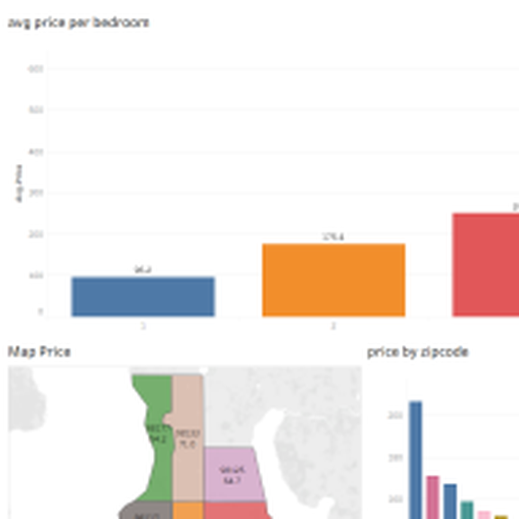
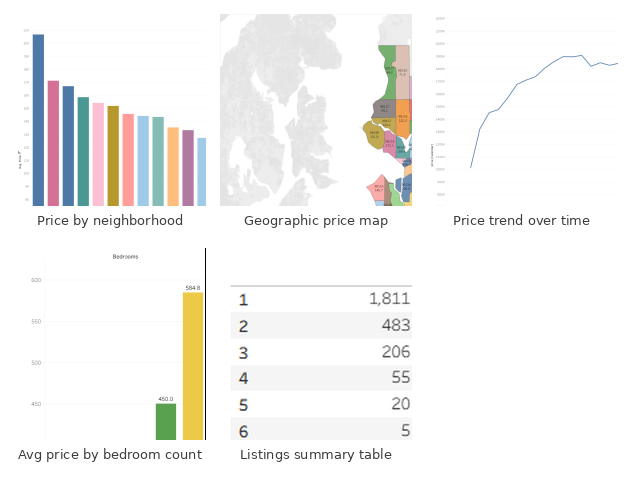

# Airbnb Pricing Dashboard (Tableau)

An interactive Tableau dashboard analyzing an Airbnb listings dataset — pricing by
neighborhood, geography, bedroom count, and time, built on a federated join between a
listings table and a nightly calendar table.

## What it shows

The main dashboard combines three views: average price per bedroom count, a geographic
choropleth of price by zip code, and price by zip code as a bar chart. Beyond the main
dashboard, the workbook includes five supporting sheets:

## Data

Seattle Airbnb listings data, joined on `listing_id`:
- **`data/listings.csv`** — 3,819 rows, one per property (price, room type, bedrooms,
  location, host and review fields)
- **`data/calendar.csv`** — 1,048,576 rows, nightly price and availability per listing
  (listings × days), which is what drives the dataset's size

The original workbook also had a Reviews sheet, left out here since only Listings and
Calendar feed the dashboard.

## Opening the dashboard

1. Install [Tableau Desktop](https://www.tableau.com/products/desktop) or the free
   [Tableau Public](https://public.tableau.com/) app.
2. Open `Airbnb_Pricing_Dashboard.twb`.
3. The workbook's connection points at the original local Excel file, so Tableau will
   prompt that it can't find the data source — reconnect it to `data/listings.csv` and
   `data/calendar.csv` (Data → Edit Data Source), keeping the join on `listing_id`.

## Note on the screenshots

These previews are pulled from Tableau's own embedded thumbnail cache in the `.twb`
file rather than a fresh export, so they're small and a little soft — accurate to the
dashboard, just not high-resolution. If you have Tableau installed, exporting proper
full-size images (Dashboard → Export Image) and swapping them into `assets/` would be
a nice upgrade for the repo.

## Tech stack

- **Tableau** — dashboard authoring, joins, and geographic visualization
